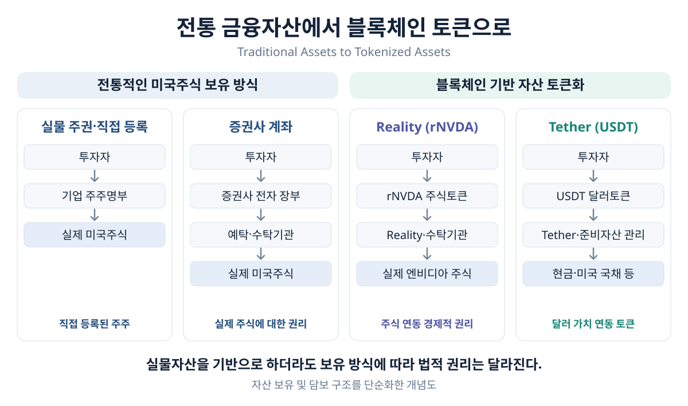
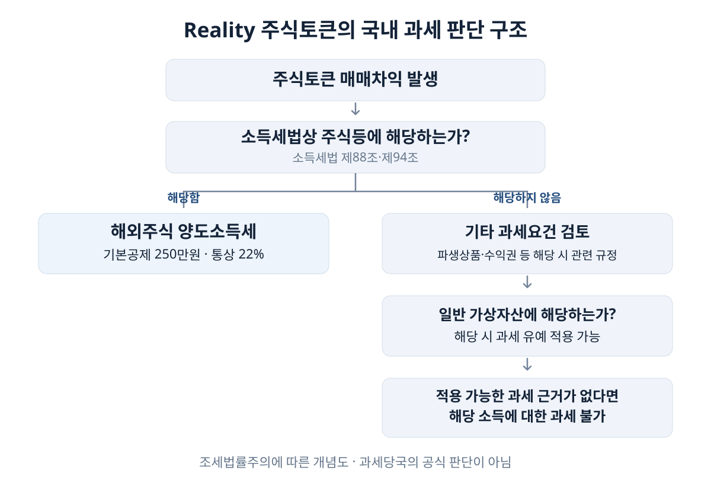
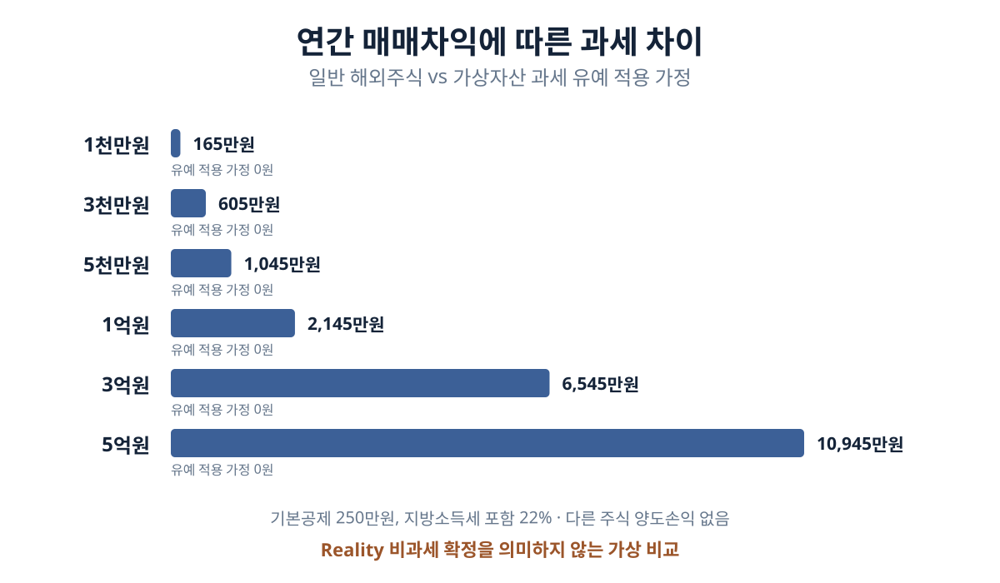

# 테더는 달러인가, rNVDA는 엔비디아 주식인가? 미국주식을 보유하는 세 가지 방법

**실물 주권에서 증권사 전자 장부, 그리고 블록체인으로. 토큰화 미국주식의 등장으로 달라지는 자산 소유 방식과 과세 체계.**

2026년 11월 27일 | USStockLive

가상자산 투자자들에게 테더(USDT)는 사실상 달러처럼 사용된다. 그러나 테더를 보유한다고 해서 미국 달러 지폐나 미국 국채를 직접 소유하는 것은 아니다.

비트겟(Bitget)에서 거래되는 Reality의 토큰화 미국주식도 비슷한 개념에서 출발한다. 실제 엔비디아 주식을 기초자산으로 보유하고, 이를 기반으로 rNVDA라는 디지털 토큰을 발행한다.

그렇다면 국내 증권사를 통해 엔비디아 주식을 매수하는 것은 어떨까.

투자자가 종이로 된 실물 주권을 받는 것도 아니고, 엔비디아의 주주명부에 투자자 본인의 이름이 직접 올라가는 것도 일반적이지 않다.

실물 주권, 증권사 계좌 속 미국주식, 그리고 블록체인 위의 주식토큰. 이 세 가지는 무엇이 같고 무엇이 다를까.

## 1. 테더와 Reality 주식토큰의 공통점

테더와 Reality는 모두 전통적인 금융자산을 바탕으로 블록체인에서 거래할 수 있는 디지털 자산을 발행한다.

테더는 현금성 자산과 미국 국채 등을 준비자산으로 보유하며, 1USDT가 1달러에 가까운 가치를 유지하도록 설계됐다.

Reality는 실제 미국주식과 ETF를 기반으로 해당 자산의 경제적 가치를 추종하는 주식토큰을 발행한다.

비트겟의 공식 설명에 따르면 rNVDA 1개에는 엔비디아 주식 1주에 해당하는 기초자산이 뒷받침된다. 단순히 주가 변동만 추종하는 합성 파생상품과는 다른 구조다.

| 구분 | 테더(USDT) | Reality(rNVDA) |
|---|---|---|
| 연동 대상 | 미국 달러 | 엔비디아 주식 |
| 준비자산 | 현금·미국 국채 등 | 엔비디아 주식 |
| 목표 가치 | 1달러 | 엔비디아 1주 가격 |
| 발행사 | Tether | Reality |
| 블록체인 거래 | 가능 | 가능 |
| 기초자산 직접 소유 | 아님 | 직접 등록된 주식 소유권 아님 |
| 기초자산 수익 분배 | 일반 보유자에게 미지급 | 배당금 지급 |
| 가격 변동 | 달러 가치에 연동 | 기초주식 가격에 연동 |

테더가 달러의 경제적 가치를 가상자산 시장으로 가져왔다면, Reality는 미국주식의 경제적 가치를 가상자산 시장으로 가져온 셈이다.

다만 두 상품의 구체적인 계약상 권리와 상환 구조가 동일한 것은 아니다.

## 2. 미국주식을 보유하는 세 가지 방법

### ① 실물 주권 및 직접 등록 방식

전통적인 주식 보유 방식은 투자자의 이름을 기업의 주주명부에 등록하고, 이를 증명하는 종이 주권을 발급받는 것이다.

오늘날에는 종이 주권 없이도 기업이나 명의개서대리인의 장부에 투자자 이름을 직접 등록하는 DRS(Direct Registration System) 방식이 존재한다.

**투자자 → 기업 주주명부 → 실제 미국주식**

투자자는 해당 기업에 직접 등록된 주주가 되며, 보유한 주식에 부여된 배당 및 의결권 등을 행사할 수 있다.

다만 종이 주권은 보관과 이전이 불편하고 분실이나 훼손의 위험도 있다. 모든 기업이 종이 주권 발행을 지원하는 것도 아니다.

### ② 증권사를 통한 미국주식 보유

오늘날 대부분의 개인투자자가 이용하는 방식이다.

한국 투자자가 국내 증권사를 통해 엔비디아 주식을 매수하면, 일반적인 외화증권 집중예탁 구조에서는 국내 증권사와 한국예탁결제원, 해외 보관기관 등을 통해 주식을 보관한다.

**투자자 → 국내 증권사 → 한국예탁결제원 → 해외 보관기관 → 실제 미국주식**

투자자의 증권계좌에는 보유 수량과 취득 가격 등이 기록된다.

투자자의 이름이 엔비디아 주주명부에 직접 등록되지 않더라도 실제 주식에 대한 권리를 보유한다. 이러한 권리는 관련 법률과 예탁제도를 통해 보호받는다.

배당금과 주식분할 등의 경제적 권리도 전달되며, 의결권 역시 증권사와 수탁기관의 지원 절차에 따라 행사할 수 있다.

### ③ Reality를 통한 토큰화 미국주식 보유

Reality 역시 실제 미국주식을 보관기관에 보관하는 구조를 채택하고 있다.

비트겟은 미국 증권사 및 수탁 인프라를 통해 기초주식을 확보하고, 독립적인 자산 보관 구조와 블록체인 기술을 활용해 rToken을 발행한다고 설명한다.

**투자자 → 비트겟 → Reality 주식토큰 → 수탁기관 → 실제 미국주식**

기존 증권사가 투자자의 주식 보유 권리를 계좌 장부에 기록한다면, Reality는 기초주식에 대한 경제적 권리를 블록체인 기반 토큰으로 표현한다.

실제 주식을 기반으로 한다는 공통점은 있지만, 증권사 고객의 주식 보유 권리와 Reality 토큰의 계약상 권리가 법적으로 동일한 것은 아니다.

테더가 달러의 가치를 블록체인 위에서 거래할 수 있도록 만들었다면, Reality는 미국주식의 경제적 가치를 블록체인 위에서 거래할 수 있도록 만들었다.

두 상품 모두 실제 금융자산을 기반으로 하지만, 투자자가 거래하는 것은 기초자산 자체가 아닌 발행사가 발행한 디지털 토큰이다.

이는 토큰화 자산의 소유권과 과세 체계를 판단할 때 기초자산과 토큰 자체를 구분해야 하는 이유이기도 하다.

## 3. 실물 주식·증권사·토큰화 주식 비교

| 비교 항목 | 실물 주권·직접 등록 | 국내 증권사 | Reality 주식토큰 |
|---|---|---|---|
| 보유 자산 | 실제 주식 | 실제 주식에 대한 권리 | 주식 연동 토큰 |
| 권리 기록 | 기업 주주명부 | 증권계좌·예탁 장부 | 블록체인·거래소 장부 |
| 실물 주식 기반 | O | O | O |
| 주주명부 직접 등록 | O | 일반적으로 X | X |
| 의결권 | O | 절차에 따라 가능 | X |
| 배당금 수령 | O | O | O |
| 주식분할 반영 | O | O | O |
| 주말 거래 | X | 일반적으로 X | 지원 종목 가능 |
| 거래통화 | USD | USD 등 | USDT |
| 소수점 매매 | 일반적으로 X | 일부 지원 | 지원 |
| 블록체인 전송 | X | X | 지원 토큰 가능 |
| 가상자산 담보 활용 | X | 일반적으로 X | 지원 종목 가능 |
| 양도차익 과세 | 해외주식 과세 | 해외주식 과세 | 법적 분류 확인 필요 |
| 투자자 보호 | 증권 관련 법률 | 증권·예탁제도 | 계약 및 수탁 구조에 따라 상이 |

세 가지 방식 모두 미국주식의 경제적 가치와 연결돼 있지만, 권리를 기록하는 방식과 투자자가 보유하는 법적 권리에는 차이가 있다.

## 4. 의결권의 차이, 기업의 주주인가 경제적 권리의 보유자인가

실제 미국주식과 Reality 주식토큰의 중요한 차이 중 하나는 의결권이다.

일반적으로 의결권이 부여된 주식의 주주는 이사 선임, 인수합병, 정관 변경 등 기업의 주요 경영 의사결정에 참여할 수 있다.

직접 등록 방식으로 주식을 보유한 투자자는 이러한 권리를 직접 행사할 수 있다. 증권사를 통해 미국주식을 매수한 투자자 역시 증권사와 해외 보관기관의 절차에 따라 의결권을 행사할 수 있다.

반면 Reality 주식토큰 보유자에게는 기초주식에 대한 의결권이 부여되지 않는다.

| 주주 권리 | 직접 등록 | 국내 증권사 | Reality |
|---|---|---|---|
| 이사 선임 투표 | 가능 | 절차에 따라 가능 | 불가능 |
| 주요 경영 안건 투표 | 가능 | 절차에 따라 가능 | 불가능 |
| 주주총회 참여 | 가능 | 거의 불가능에 가까움 | 주주 자격 미부여 |
| 주가 상승에 따른 수익 | 가능 | 가능 | 가능 |
| 배당금 수령 | 가능 | 가능 | 가능 |
| 주식분할 반영 | 가능 | 가능 | 가능 |

*의결권이 부여된 일반 보통주 기준.*

Reality 주식토큰 역시 기초주식에서 배당금이 발생하면 상품 정책에 따라 세금 등을 차감한 금액을 USDT로 지급하며, 주식분할 등 지원되는 기업행위도 반영한다.

기업 경영에 참여하기보다는 매매차익과 배당 수익을 목적으로 투자하는 개인투자자에게 의결권의 부재는 실질적인 투자 경험에서 큰 차이를 만들지 않을 수도 있다.

그러나 경제적 수익을 얻는 것과 법적으로 동일한 주주 권리를 보유하는 것은 별개의 문제다.

## 5. Reality 주식토큰에 해외주식 양도소득세를 부과할 수 있을까

한국 투자자에게 토큰화 미국주식의 가장 흥미로운 쟁점 중 하나는 과세 문제다.

현재 한국에서 일반적인 해외주식 매매차익은 연간 기본공제 250만원을 제외하고 지방소득세를 포함해 22%의 세율을 적용받는다.

그렇다면 실제 미국주식을 기초자산으로 하는 Reality 주식토큰에도 동일한 세율을 적용할 수 있을까.

### 한국의 조세법률주의와 소득세 열거주의

대한민국 헌법 제59조는 다음과 같이 규정하고 있다.

> 조세의 종목과 세율은 법률로 정한다.

한국의 소득세 체계는 법률에서 정한 소득 유형을 중심으로 과세하는 열거주의를 기본으로 한다.

경제적 이익이 발생했다는 사실만으로 과세할 수 있는 것이 아니라, 해당 소득에 적용할 법률상 과세 근거가 존재해야 한다.

소득세법 제88조 제2호에서는 양도소득세 과세와 관련한 '주식등'의 범위를 다음과 같이 규정하고 있다.

> 주식 또는 출자지분을 말하며, 신주인수권과 대통령령으로 정하는 증권예탁증권을 포함한다.

소득세법 제94조 제1항 제3호에서는 일정한 외국법인 발행 주식이나 해외시장 상장 주식 등의 양도소득을 과세 대상으로 규정하고 있다.

따라서 Reality 주식토큰의 매매차익에 해외주식 양도소득세를 적용하려면 우선 해당 토큰이 현행 소득세법에서 정의하는 '주식등'에 해당하는지를 판단해야 한다.

### 기초자산이 주식이라고 해서 거래 대상도 주식일까

테더는 준비자산의 일부로 미국 국채를 보유한다.

그러나 투자자가 USDT를 거래한다고 해서 그 거래가 곧바로 미국 국채의 매매로 분류되는 것은 아니다.

투자자가 보유하고 거래하는 자산은 미국 국채 자체가 아닌 테더라는 디지털 토큰이기 때문이다.

Reality에도 유사한 질문을 적용할 수 있다.

| 구분 | USDT | rNVDA |
|---|---|---|
| 기초자산 | 미국 국채·현금 등 | 엔비디아 주식 |
| 기초자산 발행 주체 | 미국 정부 등 | NVIDIA |
| 토큰 발행 주체 | Tether | Reality |
| 투자자가 거래하는 자산 | USDT | rNVDA |
| 기초자산과 토큰의 법적 동일성 | 동일하지 않음 | 구체적 권리 구조 검토 필요 |

rNVDA는 엔비디아 주식을 기반으로 발행되지만, 엔비디아가 직접 발행한 주식은 아니다.

비트겟 역시 rToken을 기초주식의 경제적 권리를 토큰화한 상품으로 설명하며, 기초주식에 대한 직접적인 등록 소유권이나 의결권을 제공하지 않는다고 명시한다.

특히 비트겟은 자체 플랫폼에서도 실제 주식 상품인 Stock+와 토큰화 주식인 rToken을 구분하고 있다.

| 구분 | Bitget Stock+ | Reality rToken |
|---|---|---|
| 상품 성격 | 실제 미국주식 | 토큰화 미국주식 |
| 투자자 권리 | 주식 소유권 | 경제적 권리 |
| 의결권 | 제공 | 미제공 |
| 거래통화 | USDC | USDT |
| 블록체인 전송 | 미지원 | 지원 |
| 가상자산 생태계 활용 | 제한적 | 지원 |

이러한 차이는 주식토큰을 실제 해외주식과 동일한 과세 대상으로 볼 수 있는지에 대한 중요한 검토 근거가 된다.

### 현행 소득세법의 과세 대상에 해당하는가

Reality 주식토큰에 대한 과세 여부는 다음과 같은 법적 분류를 통해 검토할 필요가 있다.

| 현행법상 분류 | Reality 관련 검토 사항 |
|---|---|
| 외국법인이 발행한 주식 | 기초주식과 토큰 자체의 법적 관계 |
| 출자지분 | 발행법인에 대한 지분권 존재 여부 |
| 증권예탁증권(DR) | 예탁증권의 법정 요건 충족 여부 |
| 파생상품·파생결합증권 | 계약 구조와 법정 과세 대상 해당 여부 |
| 신탁수익권·기타 금융상품 | 기초자산에 대한 권리 및 수익분배 구조 |
| 가상자산 | 관련 법령상 정의 및 제외 대상 해당 여부 |

법률에 Reality 또는 rNVDA라는 상품명이 직접 명시되어야 과세할 수 있다는 의미는 아니다.

새로운 금융상품이라도 기존 법률에서 정한 과세 대상의 정의와 요건에 해당한다면 과세가 가능하다.

국세기본법 제14조에 따른 실질과세 원칙 역시 상품의 명칭이나 외형이 아닌 실질적인 거래와 권리 관계를 기준으로 적용된다.

다만 실질과세 원칙이 법률에 없는 새로운 과세 대상을 만들어낼 수 있다는 의미는 아니다.

결국 중요한 것은 주식토큰이라는 명칭도, 실제 주식을 담보하고 있다는 사실도 아닌 투자자가 보유한 권리의 실질이 현행법상 어떤 과세 대상에 해당하는가이다.

### 가상자산 과세는 2029년으로 추가 유예될까

한국의 가상자산 양도·대여 소득 과세는 당초 2022년 시행 예정이었으나 여러 차례 유예됐다.

| 구분 | 과세 시행 예정 시점 |
|---|---|
| 최초 도입 일정 | 2022년 1월 |
| 1차 유예 | 2023년 1월 |
| 2차 유예 | 2025년 1월 |
| 3차 유예 | 2027년 1월 |
| 4차 유예 추진 | 2029년 1월 |

2026년 11월 5일 정부는 가상자산 소득 과세를 2029년까지 2년 추가 유예하는 방안을 공식 발표했다.

이후 11월 9일 관련 소득세법 개정안이 국회에 발의됐다.

2026년 11월 11일 여야 잠정합의로 마무리되었다.

### 매매차익에 따라 얼마나 큰 세금 차이가 발생할까

Reality 주식토큰이 기존 금융상품 관련 과세요건에 해당하지 않고 일반 가상자산의 과세 체계를 적용받는다고 가정해 보자.

추가 과세 유예가 확정된다면 2028년 말까지 일반 해외주식과 상당한 세금 차이가 발생할 가능성이 있다.

| 연간 매매차익 | 일반 해외주식 양도소득세 | 가상자산 과세 유예 적용 시 | 세금 차이 |
|---|---:|---:|---:|
| 1,000만원 | 165만원 | 0원 | 165만원 |
| 3,000만원 | 605만원 | 0원 | 605만원 |
| 5,000만원 | 1,045만원 | 0원 | 1,045만원 |
| 1억원 | 2,145만원 | 0원 | 2,145만원 |
| 3억원 | 6,545만원 | 0원 | 6,545만원 |
| 5억원 | 1억 945만원 | 0원 | 1억 945만원 |

*한국 세법상 거주 개인투자자 기준. 일반 해외주식 기본공제 250만원 및 지방소득세 포함 22% 적용. 다른 과세 대상 주식의 양도손익이 없다는 가정이며, 일반 가상자산 과세 유예를 적용한 가상 비교다.*

이러한 과세 차이는 투자금액과 매매차익이 커질수록 더욱 확대된다.

다만 현재 공개된 자료에서는 Reality 주식토큰을 해외주식 또는 일반 가상자산으로 분류한다는 국내 과세당국의 개별 유권해석이 확인되지 않는다.

주식토큰이 일반 가상자산에 해당한다면 관련 과세 유예 규정을 적용받을 가능성이 있지만, 기존 세법상 다른 과세 대상 금융상품에 해당한다면 그에 따른 과세가 가능하다.

배당금과 예치 보상 등 매매차익 이외의 수익 역시 각각의 소득 성격에 따라 별도로 판단해야 한다.

따라서 Reality 주식토큰의 매매차익에 해외주식 양도소득세 22%가 당연히 적용된다고 볼 수도 없으며, 반대로 비과세가 확정됐다고 단정할 수도 없다.

## 6. 미국주식을 토큰으로 전환하는 시대

2026년 10월 15일 비트겟은 기존 증권사에서 보유한 미국주식을 rToken으로 전환하는 주식 이전 서비스에 대한 공식 안내를 발표했다.

지원되는 미국주식을 외부 증권계좌에서 이전하면 이를 기반으로 rToken이 발행된다.

반대로 rToken을 외부 증권사로 이전하는 서비스도 지원한다.

**기존 증권사 미국주식 ↔ Reality 주식토큰**

| 구분 | 비트겟 공식 안내 |
|---|---|
| 실제 미국주식 → rToken | 지원 |
| rToken → 외부 증권사 | 지원 |
| 비트겟 입고 수수료 | 무료 |
| 외부 증권사 출고 수수료 | 종목별 신청당 150달러 |
| 예상 처리 기간 | 약 10영업일 |
| 소수점 주식 이전 | 미지원 |
| 타인 명의 계좌 이전 | 미지원 |

기존 증권시장에서 보유하던 주식을 가상자산 생태계에서 활용할 수 있는 형태로 전환하는 통로가 마련된 것이다.

전환된 주식토큰은 지원 조건에 따라 담보대출, 자동매매, 블록체인 전송 등의 용도로 활용할 수 있다.

다만 국내 증권사에서도 해당 서비스가 지원되는지, 주식을 토큰으로 전환하는 과정 자체가 국내 세법상 양도에 해당하는지는 별도로 확인해야 한다.

## 7. 미국주식은 주말에도 움직일 수 있을까

토큰화 미국주식의 가장 큰 차별점 중 하나는 거래시간이다.

전통적인 미국 증권시장은 주말과 공휴일에 휴장한다. 평일에는 정규장뿐 아니라 프리마켓, 애프터마켓, 일부 증권사의 야간거래도 가능하다.

반면 비트겟의 주요 주식토큰은 주말과 미국 증시 휴장일에도 거래할 수 있다.

예를 들어 엔비디아가 금요일 150달러에 마감한 이후 주말에 새로운 악재가 발생했다고 가정해 보자.

| 시점 | 미국주식 최근 종가 | rNVDA 가격 | 종가 대비 차이 |
|---|---:|---:|---:|
| 금요일 마감 | $150 | 150 USDT | 0% |
| 토요일 | $150 | 145 USDT | -3.33% |
| 일요일 | $150 | 141 USDT | -6.00% |

*가격 형성 원리를 설명하기 위한 가상 시나리오.*

미국 증권시장이 휴장한 동안에도 주식토큰 시장에서는 투자자의 매수·매도 주문에 따라 새로운 가격이 형성된다.

이는 기존 증권시장에서 확인할 수 없었던 주말 투자심리를 관찰할 수 있다는 의미다.

USStockLive는 이러한 토큰화 미국주식 가격과 실제 미국주식 최근 종가의 차이를 실시간으로 비교해 제공한다.

다만 주식토큰 가격은 거래량과 유동성, 호가 차이, USDT 가치 변동 등의 영향을 받는다.

따라서 미국 증시의 다음 개장 가격을 가늠하는 참고 지표가 될 수는 있지만 실제 개장 가격을 보장하지는 않는다.

## 8. 거래소나 발행사가 파산하면 어떻게 될까

실물자산을 1:1로 보유하고 있다는 사실과 투자자가 해당 실물자산을 법적으로 직접 소유하고 있다는 사실은 서로 다른 문제다.

기존 증권시장은 고객 자산과 증권사 고유재산의 분리, 집중예탁, 투자자 보호 등 오랜 기간 구축된 제도를 갖추고 있다.

Reality 역시 기초주식을 별도로 보관하고, 외부 회계법인을 통해 발행 토큰과 준비자산의 일치 여부를 검증하는 구조를 갖췄다고 설명한다.

그러나 토큰화 미국주식은 기존 주가 변동 위험에 더해 다음과 같은 추가 위험을 수반한다.

- 토큰 발행사의 파산 및 운영 위험
- 거래소의 지급불능 및 출금 제한 위험
- 수탁기관 및 준비자산 관리 위험
- 블록체인 및 스마트컨트랙트 오류
- 거래통화인 USDT의 가치 변동 위험
- 국가별 규제 및 과세 체계 변경 위험

미국의 증권투자자보호공사(SIPC)는 일정한 요건을 충족하는 증권사 고객의 자산을 보호한다.

그러나 기초자산을 보관하는 증권사가 SIPC 보호 대상이라는 사실만으로 개별 Reality 토큰 투자자까지 동일한 보호를 받는다고 단정할 수는 없다.

거래소나 발행사가 파산할 경우 투자자가 기초자산에 대해 어떤 청구권을 갖는지, 자산 반환이 어떤 절차와 순위에 따라 이뤄지는지가 중요하다.

## 9. 종이 주권에서 블록체인으로

금융시장은 지속적으로 자산을 기록하고 거래하는 방식을 발전시켜 왔다.

과거에는 종이 주권이 주식 소유를 증명했다.

오늘날에는 증권사의 전자 장부가 그 역할을 수행하고 있으며, 이제는 블록체인이 새로운 자산 기록 및 거래 수단으로 등장하고 있다.

**실물 주권 → 전자 장부 → 블록체인 기반 주식토큰**

테더는 달러를 가상자산 생태계에서 거래할 수 있도록 만들었다.

Reality는 미국주식의 경제적 가치를 같은 생태계로 가져오고 있다.

주말 거래, 소수점 매매, 가상자산과 미국주식 간 자금 이동, 블록체인 전송 및 담보 활용은 기존 증권시장이 제공하기 어려웠던 새로운 투자 경험이다.

특히 기업 경영에 직접 참여하기보다는 주가 상승과 배당 수익을 목적으로 하는 개인투자자에게 토큰화 미국주식은 기존 증권계좌와는 다른 투자 수단이 될 수 있다.

과세 체계 역시 중요한 변수가 될 전망이다.

주식토큰이 현행법상 해외주식에 해당하는지, 다른 금융상품에 해당하는지, 일반 가상자산의 과세 체계를 적용받는지에 따라 투자자의 세후 수익률은 크게 달라질 수 있다.

그러나 기술의 발전이 법적 권리와 투자자 보호의 동등성을 의미하지는 않는다.

토큰화 미국주식이 기존 증권시장의 대안으로 자리 잡으려면 거래 편의성뿐 아니라 소유권, 과세, 파산 시 자산 반환 문제에 대해서도 명확한 제도가 마련돼야 한다.

결국 토큰화 시대에 투자자가 던져야 할 질문은 단순히 어떤 자산의 가격이 상승하느냐가 아니다.

**내가 매수한 자산은 법적으로 무엇이며, 그 자산에 대해 어떤 권리를 보유하고 있는가.**

이 질문에 대한 답이 토큰화 금융시장의 미래를 결정할 것이다.
